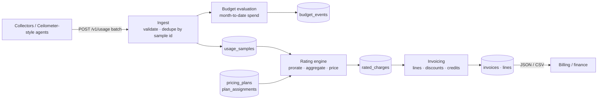

<!-- topics: fastapi,python,cloud,metering,billing,openstack,usage-based-pricing,sqlalchemy,saas -->
# Cloud Usage Metering

Usage metering, rating and invoicing for cloud resources: compute hours, GB-hours of storage, floating IPs and bandwidth, priced with tiered and regional plans and turned into invoices and budget alerts.

[](https://github.com/AkibUllah/cloud-usage-metering/actions/workflows/ci.yml)


## Why this exists

Running an OpenStack-based cloud for customers means turning Ceilometer-style samples into bills that survive scrutiny: a server that ran 37 minutes must be charged 37 minutes, the first floating IP must stay free, egress must be priced in graduated tiers, and replaying a batch of samples must never double-bill anyone. This service is that pipeline, written to be exact (Decimal end to end, no floats), idempotent (sample ids are the dedupe key, invoices regenerate in place) and testable without infrastructure.

## Features

- Batch ingest of usage samples `(tenant, resource_id, metric, quantity, start, end)` with per-sample validation and dedupe by client-supplied sample id, within a batch and across batches
- Metric registry distinguishing **gauges** (instance count, volume GB, floating IPs: level x hours) from **deltas** (egress GB, requests: totals split by time overlap)
- Rating engine that prorates samples into hourly or daily buckets, aggregates per metric and region, and prices chronologically so free tiers and graduated tiers apply across the whole period
- Pricing plans with per-metric unit prices, free quantities, graduated tiers, glob fallbacks (`compute.instance.*`) and regional overrides; plan assignment per tenant with effective dates (mid-period plan changes are priced bucket by bucket)
- Invoice generation per tenant and billing period: line items, percentage discounts (global or per metric), credits (projected on drafts, consumed on finalize), JSON and CSV export
- Budget rules per tenant (total or per metric) evaluated on every ingest; one stored and logged event per rule per period
- Exact money handling: Decimal everywhere, `NUMERIC` on Postgres and canonical strings on SQLite, so tests run on SQLite with identical results
- Usage summary endpoint that rates a period on the fly without persisting
- Optional shared API key, request ids and timing logs, `/health`
- `scripts/simulate_usage.py` generates realistic multi-tenant OpenStack-style usage (flavors, volumes, floating IPs, office-hours servers) and drives the whole flow through the API

## Architecture



Key decisions:

- **Proration by overlap.** Each sample is clipped to the billing window and split across buckets by the seconds it overlaps. Gauges become `quantity x hours`, deltas are divided proportionally. A 50 GB volume alive for 30 minutes is 25 GB-hours, no special cases.
- **Incremental pricing with a running total.** Buckets are priced in order with a per-(metric, region) consumed counter, so a free tier of 100 GB and graduated tiers over the month come out exactly equal to pricing the monthly total, while still leaving per-hour charges for drill-down.
- **Idempotency at two levels.** Samples dedupe on their id, so collectors can retry freely. Re-rating a window deletes and rewrites its charges; regenerating a draft invoice updates it in place; finalized invoices are immutable.
- **Credits are consumed only on finalize.** Drafts show the projected credit so finance can review, but nothing is deducted until the invoice is locked, which makes regeneration safe.
- **Decimal, always.** Quantities, prices and amounts are `Decimal`; per-bucket charges keep six decimals and invoice lines are rounded once at the end (half-up to 2 places).

## Tech Stack

| Layer | Choice |
| --- | --- |
| Web framework | FastAPI, Pydantic v2, pydantic-settings |
| Persistence | SQLAlchemy 2.0 ORM; SQLite (dev/tests), PostgreSQL via psycopg 3 (compose) |
| Money / time | `decimal.Decimal`, `Money` and `UTCDateTime` type decorators |
| Tooling | pytest, httpx TestClient, ruff, GitHub Actions |
| Runtime | Docker (python:3.11-slim, non-root), docker compose with Postgres 16 |

## Quick Start

### Docker compose (Postgres)

```bash
git clone git@github.com:AkibUllah/cloud-usage-metering.git
cd cloud-usage-metering
docker compose up --build -d
# API: http://localhost:8000  ·  OpenAPI docs: http://localhost:8000/docs

# Seed a BDT plan, three tenants, 3 days of hourly usage, then generate invoices
docker compose exec api python scripts/simulate_usage.py --base-url http://localhost:8000 --days 3 --invoice
```

### Local (SQLite)

```bash
python3 -m venv .venv && source .venv/bin/activate
pip install -e ".[dev]"
cp .env.example .env
uvicorn metering.asgi:app --reload

# in another shell
python scripts/simulate_usage.py --days 2 --invoice
```

Sample simulator output (`--days 3 --tenants 3 --seed 42`, October 2026):

```
samples=1368 accepted=1368 duplicates=0 rejected=0
INV-202610-00001  Pathao Labs                  BDT       475.89  (4 lines)
INV-202610-00002  Chaldal Infrastructure       BDT      1066.98  (4 lines)
INV-202610-00003  Shohoz Platform              BDT       386.77  (5 lines)
```

Run it again and every sample is reported as a duplicate while the invoices are regenerated with the same totals.

### Manual walk-through

```bash
# 1. a plan: flat compute prices, GB-hour storage, one free floating IP, tiered egress with 100 GB free
curl -s -X POST localhost:8000/v1/plans -H 'content-type: application/json' -d '{
  "id": "standard-bdt", "name": "Standard (BDT)", "currency": "BDT",
  "prices": [
    {"metric": "compute.instance.m1.small", "unit_price": "2.50"},
    {"metric": "compute.instance.m1.small", "region": "ctg-1", "unit_price": "2.00"},
    {"metric": "storage.volume.gb", "unit_price": "0.0002"},
    {"metric": "network.floating_ip", "unit_price": "0.50", "free_quantity": "744"},
    {"metric": "network.bandwidth.egress.gb", "free_quantity": "100",
     "tiers": [{"up_to": "1000", "unit_price": "8.00"}, {"up_to": null, "unit_price": "6.00"}]}
  ]}'

# 2. a tenant on that plan
curl -s -X POST localhost:8000/v1/tenants -H 'content-type: application/json' \
  -d '{"id": "acme", "name": "Acme Cloud Ltd", "default_region": "dhaka-1"}'
curl -s -X POST localhost:8000/v1/tenants/acme/plan -H 'content-type: application/json' \
  -d '{"plan_id": "standard-bdt", "effective_from": "2026-01-01T00:00:00Z"}'

# 3. usage: one small instance for 90 minutes
curl -s -X POST localhost:8000/v1/usage -H 'content-type: application/json' -d '{"samples": [
  {"id": "srv-1:compute:2026-10-01T10", "tenant_id": "acme", "resource_id": "srv-1",
   "metric": "compute.instance.m1.small", "quantity": "1",
   "start": "2026-10-01T10:00:00Z", "end": "2026-10-01T11:30:00Z"}]}'

# 4. what does October look like so far?  -> 1.5 instance-hours, 3.75 BDT
curl -s 'localhost:8000/v1/tenants/acme/usage/summary?period=2026-10'

# 5. invoice it
curl -s -X POST 'localhost:8000/v1/tenants/acme/invoices?period=2026-10'
```

## API

| Method | Path | Description |
| --- | --- | --- |
| GET | `/health` | Liveness + database check |
| GET | `/v1/metrics` | Metric registry (gauge/delta, units) |
| POST / GET | `/v1/plans` | Create plan with prices, list plans |
| GET | `/v1/plans/{plan_id}` | Plan detail |
| POST / GET | `/v1/tenants` | Create tenant, list tenants |
| GET | `/v1/tenants/{id}` | Tenant detail |
| POST | `/v1/tenants/{id}/plan` | Assign plan from `effective_from` (closes the previous assignment) |
| GET | `/v1/tenants/{id}/plan` · `/plan/history` | Current plan, assignment history |
| POST | `/v1/usage` | Ingest a batch of samples -> `accepted`, `duplicates`, `rejected[]`, `budget_events[]` |
| GET | `/v1/usage` | Query samples by tenant, metric, resource, time window |
| GET | `/v1/tenants/{id}/usage/summary?period=YYYY-MM` | Rate a period on the fly; per-metric quantity, free quantity and cost |
| POST | `/v1/tenants/{id}/invoices?period=YYYY-MM` | Generate or refresh the draft invoice |
| GET | `/v1/tenants/{id}/invoices` | Invoices of a tenant |
| GET | `/v1/invoices/{id}` · `/csv` | Invoice JSON, CSV export |
| POST | `/v1/invoices/{id}/finalize` | Lock invoice and consume credits |
| POST / GET | `/v1/tenants/{id}/credits` | Add / list credits |
| POST / GET | `/v1/tenants/{id}/discounts` | Add / list percentage discounts (optional metric glob and validity window) |
| POST / GET | `/v1/tenants/{id}/budgets` | Create / list budget rules |
| DELETE | `/v1/tenants/{id}/budgets/{rule_id}` | Delete rule |
| GET | `/v1/tenants/{id}/budget-events` | Alerts emitted for the tenant |

When `API_KEY` is set, all `/v1/*` routes require `X-API-Key`. `/health` is always open.

### Metrics

| Metric | Kind | Sample quantity | Rated unit |
| --- | --- | --- | --- |
| `compute.instance.<flavor>` | gauge | instances | instance-hour |
| `compute.vcpu`, `compute.ram.gb` | gauge | vCPUs / GB | vcpu-hour / GB-hour |
| `storage.volume.gb`, `storage.snapshot.gb`, `storage.object.gb` | gauge | GB | GB-hour |
| `network.floating_ip`, `network.loadbalancer` | gauge | count | ip-hour / lb-hour |
| `network.bandwidth.egress.gb`, `network.bandwidth.ingress.gb` | delta | GB | GB |
| `storage.object.requests` | delta | requests | request |

## Project Structure

```
src/metering/
├── asgi.py          # uvicorn entrypoint
├── main.py          # create_app() factory
├── config.py        # Settings
├── database.py      # engine/session, Money + UTCDateTime type decorators
├── models.py        # Tenant, UsageSample, PricingPlan/PlanPrice, PlanAssignment, RatedCharge, Invoice, Credit, Discount, BudgetRule/Event
├── metrics.py       # metric registry (gauge vs delta)
├── periods.py       # YYYY-MM periods, hourly/daily buckets, overlap maths
├── pricing.py       # PriceSpec, Tier, graduated/free-tier rating, PriceBook resolution
├── plans.py         # plan in force at a time, assignment with effective dates
├── rating.py        # prorate -> aggregate -> price -> RatedCharge
├── ingest.py        # batch validation + dedupe
├── invoices.py      # lines, discounts, credits, finalize, CSV
├── budgets.py       # threshold rules, one event per rule per period
├── schemas.py       # Pydantic models
├── deps.py          # API key + tenant lookup dependencies
└── routers/         # health, plans, tenants, usage, invoices, budgets
scripts/simulate_usage.py   # realistic usage generator / end-to-end driver
tests/                      # 50 tests, SQLite in-memory
```

## Testing

```bash
make test        # or: pytest
make lint
```

Coverage highlights:

- pricing: flat, free tier, graduated tiers, free tier + tiers, incremental == total, tier validation, regional/glob resolution order
- rating: partial-hour proration, multi-bucket gauges, proportional deltas, window clipping, daily buckets, aggregation, free tier across buckets, regional override, mid-period plan change, unpriced metrics, re-rating idempotency
- ingest: batch accept, duplicates within and across batches, replay does not double-bill, rejection reasons, validation, batch size limit, API key enforcement
- invoices: totals equal line sums (hand-computed), global and per-metric discounts, expired discounts, credits projected vs consumed, oversize credit remainder, expired credits, finalize lock, CSV export
- budgets: fires once per period, metric-scoped rules, disabled rules, separate periods, no-plan tenants
- simulator: deterministic generation, end-to-end run and idempotent re-run through the API, JSON output mode

## Roadmap

- Alembic migrations (tables are created with `create_all` at startup)
- Async rating worker so budget evaluation and invoice generation leave the request path
- Commitment / reserved pricing (prepaid instance-hours) alongside pay-as-you-go
- Invoice PDF rendering and a webhook sink for budget events
- Ingest adapter for Ceilometer / Gnocchi measures

## License

MIT © 2026 Akib Jafor
